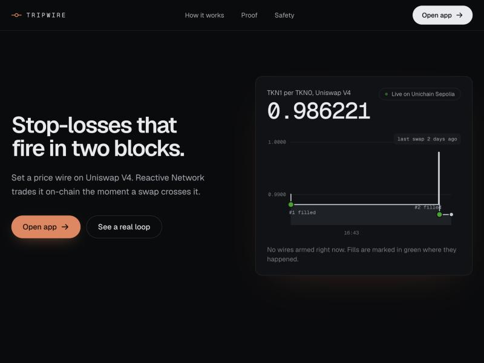
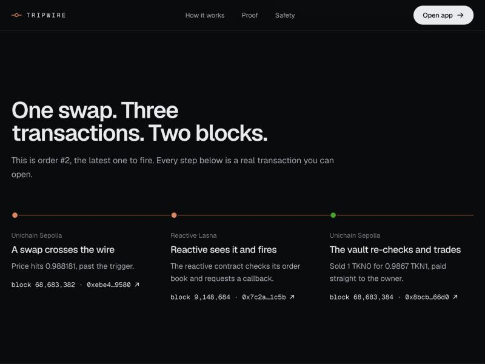
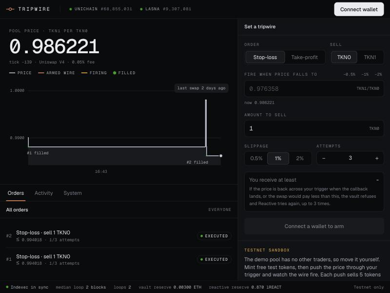
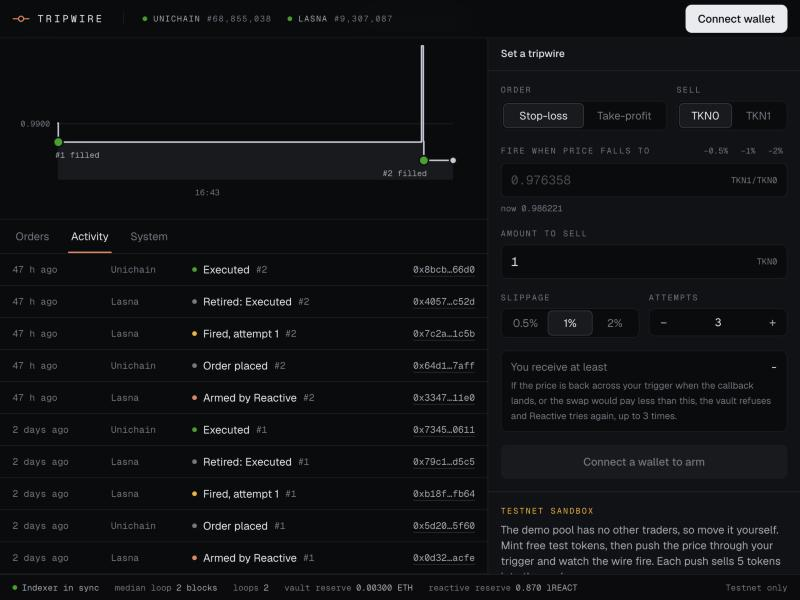
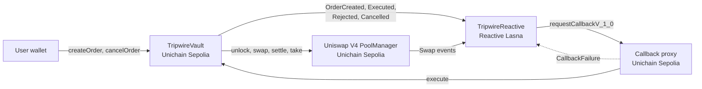
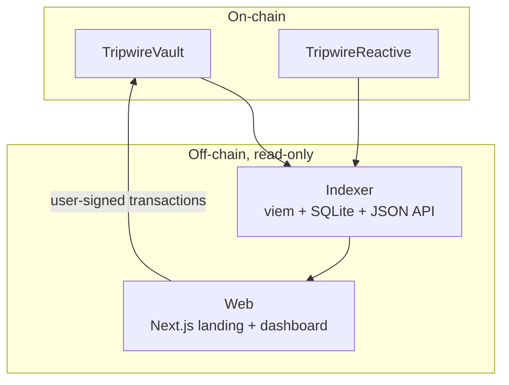

# Tripwire


**Your stop-loss fires in two blocks. No bot required.**

DEX traders who want a stop-loss or take-profit today have to run a bot, trust a keeper network, or rely on off-chain fillers, and every one of those can be offline at the exact moment the price crashes.
Tripwire puts the trigger on-chain: Reactive Network watches every swap in a Uniswap V4 pool and calls the vault the moment one crosses an order's price.
The vault re-checks the live price, enforces the user's minimum output, and swaps, with proceeds paid straight to the order owner.

Live frontend: runs locally (not hosted yet) · Indexer: runs locally · Contracts on Unichain Sepolia and Reactive Lasna testnet.

[See it in one command](#see-it-in-one-command) · [Architecture](#architecture) · [Safety](#safety-enforced-in-code) · [Honesty table](#whats-real-vs-pending---the-honesty-table) · [Tests](#tests) · [Demo](#the-one-flow-demo)

Built for the Reactive Omni Buildathon, *Every Second Counts* track, under the MIT license.
Tripwire is a testnet prototype using test tokens. It is not financial advice and has not been audited.

## Table of contents

- [See it in one command](#see-it-in-one-command)
- [Screenshots](#screenshots)
- [The one rule](#the-one-rule)
- [What Tripwire does](#what-tripwire-does)
  - [Stop-loss and take-profit orders](#stop-loss-and-take-profit-orders)
  - [Event-driven triggering on Reactive](#event-driven-triggering-on-reactive)
  - [Refuse, re-arm, retry](#refuse-re-arm-retry)
  - [Full-loop latency proof](#full-loop-latency-proof)
  - [Dashboard and landing page](#dashboard-and-landing-page)
- [Architecture](#architecture)
- [Component by component](#component-by-component)
- [Safety, enforced in code](#safety-enforced-in-code)
- [How it uses Reactive Network and Unichain](#how-it-uses-reactive-network-and-unichain)
- [Engineering decisions and the hard problems](#engineering-decisions-and-the-hard-problems)
- [What's real vs pending - the honesty table](#whats-real-vs-pending---the-honesty-table)
- [Tests](#tests)
- [Run it locally](#run-it-locally)
  - [1. Contracts](#1-contracts)
  - [2. Indexer](#2-indexer)
  - [3. Web](#3-web)
- [The one-flow demo](#the-one-flow-demo)
- [Configuration](#configuration)
- [Deploy](#deploy)
- [Project layout](#project-layout)
- [Tech stack, credits, roadmap](#tech-stack-credits-roadmap)
- [Disclaimer and license](#disclaimer-and-license)

## See it in one command

The contracts are already deployed, so running the indexer and the web app is enough to see live data.

```bash
cd Tripwire && pnpm install && node indexer/src/main.ts  # indexer + API on :8787
```

```bash
cd Tripwire && pnpm --dir web dev  # landing on :3000, dashboard on :3000/app
```

Open http://localhost:3000 for the landing page and http://localhost:3000/app for the dashboard.
The indexer backfills every Tripwire event from the deployment blocks on first start, so both executed orders, their three-transaction timelines and the latency figures appear within a few seconds.
To place an order, connect a browser wallet on Unichain Sepolia (chain ID 1301), mint test tokens from the sandbox panel, set a wire and push the price through it.

## Screenshots









## The one rule

**A trigger is a request. Only the vault decides whether funds move.**

Reactive Network tells the vault *when* to look; it never decides *whether* to trade.
That rule is enforced in three layers:

1. **Authentication.** `TripwireVault.execute` accepts calls only from Reactive's callback proxy, and only on behalf of the one reactive contract bound at deployment (`onlyServiceProvider` plus `onlyCallbackSender`).
2. **Re-validation.** Before swapping, the vault reads the live pool price with `StateLibrary.getSlot0` and refuses (`OrderRejected: PriceNotCrossed`) if the price is back on the wrong side of the trigger.
3. **Bounded outcome.** The swap runs inside a self-call wrapped in `try/catch`; if it would pay less than the order's `minAmountOut`, the whole swap and the status change roll back, the funds stay escrowed and the order can retry or be cancelled.

## What Tripwire does

### Stop-loss and take-profit orders

Users escrow the token they want to sell and set a trigger price on the demo Uniswap V4 pool.

```text
createOrder(poolId, zeroForOne, isStopLoss, triggerSqrtPriceX96, amountIn, minAmountOut, maxAttempts)
```

Whether an order fires on a fall or a rise follows from the token sold and the order type (`zeroForOne == isStopLoss` fires on a fall), so all four combinations work.
It is real because the escrow, validation and swap are in `contracts/src/TripwireVault.sol` and run against the deployed Uniswap V4 PoolManager.

### Event-driven triggering on Reactive

`TripwireReactive` on Lasna subscribes to the pool's V4 `Swap` events and the vault's order events, and keeps its own order book.

```text
Swap (Unichain) -> react() on Lasna -> pop crossed orders from a price heap -> requestCallbackV_1_0 -> execute() on Unichain
```

Orders sit in two storage heaps per pool, so each swap only touches the orders it actually crossed.
It is real because it runs on the post-Omni Reactive API (`reactive-lib-omni`, system contract `0x8888…8888`) and has fired on testnet.

### Refuse, re-arm, retry

Every outcome is reported back on-chain, and the reactive contract reacts to it.

```text
OrderRejected(PriceNotCrossed | SwapFailed) or CallbackFailure -> re-arm, up to maxAttempts
OrderRejected(NotOpen) or OrderExecuted or OrderCancelled -> retire
```

It is real because the full-loop fork tests drive both contracts through price bounce-back, slippage failure and cancel-while-in-flight.

### Full-loop latency proof

`OrderExecuted` carries the origin swap's transaction hash, block and log index, so each execution is linked on-chain to the swap that caused it.
The indexer joins the three transactions per attempt and reports the loop in Unichain blocks.
It is real because the figures come from live testnet executions (see [Observed latency](#how-it-uses-reactive-network-and-unichain)).

### Dashboard and landing page

The landing page shows the live pool, the latest real loop and live latency figures.
The dashboard is a trading-terminal layout: chart with order wires, an order ticket, orders with per-attempt timelines, a cross-chain activity feed and a status bar with prepaid balances.
A wallet picker lists every browser wallet the page detects (EIP-6963) and, when a WalletConnect project id is set, phone wallets via QR code.
It is real because every number on both pages comes from the indexer or the chain; nothing is mocked.

## Architecture

Two decisions shape everything:

1. **The vault is the source of truth; the reactive contract is a mirror.** Reactive contracts cannot read origin-chain state, so `TripwireReactive` learns orders from events and the vault re-checks everything that matters.
2. **Both contracts are immutable and bound to each other.** The deploy script predicts the vault's address from the deployer's next Unichain nonce, deploys the reactive contract with it, then deploys the vault at exactly that address.





| Tier | Runs | Can it move funds? | Responsibility |
| --- | --- | --- | --- |
| TripwireVault | Unichain Sepolia | Yes, only the order owner's escrow, only via owner cancel or authenticated execute | Escrow, price re-check, V4 swap, payout |
| TripwireReactive | Reactive Lasna | No | Mirror the order book, detect crossings, request callbacks, re-arm or retire |
| Indexer | Local Node 24 process | No | Watch both chains, join loops, serve the API |
| Web | Browser | No, only asks the user's wallet to sign | Landing page, dashboard, order ticket, sandbox |

## Component by component

**Contracts** (`contracts/src`)

| File | Responsibility |
| --- | --- |
| `TripwireVault.sol` | Escrows orders, authenticates callbacks, re-checks price, swaps through `PoolManager.unlock`, pays out |
| `TripwireReactive.sol` | Subscribes to swaps and vault events, keeps price heaps, requests and re-arms callbacks |
| `libraries/OrderHeap.sol` | Storage min-heap with lazy deletion; max-heap by inverted keys |
| `interfaces/ITripwireVault.sol` | Shared events and the callback signature both chains rely on |
| `spike/*` | Phase 0 latency probe used to prove the loop before building the product |

**Indexer** (`indexer/src`)

| File | Responsibility |
| --- | --- |
| `watcher.ts` | Polls each chain, fetches logs in RPC-sized ranges, stamps block time and first-seen time, handles load-balancer head races |
| `db.ts` | SQLite event store; each batch commits atomically with its cursor |
| `timeline.ts` | Rebuilds each order's attempts across both chains and computes same-chain latency |
| `stats.ts` | Nearest-rank median and p95 |
| `api.ts` | `/api/health`, `/api/orders`, `/api/orders/:id`, `/api/latency`, `/api/activity`, `/api/swaps`, `/api/pool`, `/api/balances` |

**Web** (`web`)

| File | Responsibility |
| --- | --- |
| `app/page.tsx` + `components/landing/*` | Landing page with live hero, loop, proof, safety and footer |
| `app/app/page.tsx` | Dashboard layout: chart, order ticket, tabs, status bar |
| `components/PriceWire.tsx` | Live price chart with order wires, draft wire, fill markers, hover tooltip and screen-reader table |
| `components/OrderForm.tsx` | Order ticket with direction-aware presets, minimum-output maths, approve and arm |
| `components/OrdersPanel.tsx` | Orders with per-attempt timelines and cancel |
| `components/ActivityFeed.tsx` | Cross-chain event feed |
| `components/WalletPicker.tsx` | Wallet dialog: detected browser wallets, WalletConnect, install hint |
| `lib/price.ts` | Exact sqrtPriceX96 maths with bigint integer square root |

## Safety, enforced in code

| Claim | How it's enforced |
| --- | --- |
| Only our reactive contract can trigger a swap | `onlyServiceProvider` (callback proxy) and `onlyCallbackSender(rvm)` on `execute` |
| A stale trigger cannot trade | Live `getSlot0` re-check before every swap; `PriceNotCrossed` rejection otherwise |
| A bad fill cannot happen | `minAmountOut` is required to be non-zero and checked inside `unlockCallback`; a shortfall reverts the swap |
| A failed swap leaves funds safe | Swap runs in `try this.performSwap(...)`; status change and swap roll back together |
| Cancel always works | Owner-only `cancelOrder` refunds immediately; a late callback hits `NotOpen` and does nothing |
| No re-entry | Transient-storage lock on `createOrder`, `cancelOrder` and `execute` |
| No under-escrow | Balance-delta check rejects fee-on-transfer tokens |
| Operator budget cannot be drained by one order | `maxAttempts` capped at 5; every attempt is a paid callback |
| No hooks or native-ETH surprises | `setPoolSupported` rejects pools with hooks or native currency |
| Reactions fit the gas cap | At most 5 triggers and 20 heap pops per swap; worst case measured at about 106k gas from cold storage plus callback allowance, under the 900k cap |

## How it uses Reactive Network and Unichain

**Reads (subscriptions on Lasna).**
`TripwireReactive` subscribes to `Swap` on the V4 PoolManager filtered to the demo pool id, to `OrderCreated`, `OrderCancelled`, `OrderExecuted` and `OrderRejected` on the vault, and to the callback proxy's `CallbackFailure` filtered to the vault.

**Writes.**
On Lasna the reactive contract calls `SYSTEM.requestCallbackV_1_0` with a 600k gas limit.
On Unichain the callback proxy delivers `execute` to the vault, which swaps through `PoolManager.unlock`.

| Contract | Chain | Address |
| --- | --- | --- |
| TripwireVault | Unichain Sepolia (1301) | `0x4F7248ca7Ed3A24E5cD12A2D5fb2C3C360Cd5892` |
| TripwireReactive | Reactive Lasna (5318007) | `0xd316a363B1AD478341Ba454Ef909703732aE31AE` |
| Uniswap V4 PoolManager | Unichain Sepolia | `0x00B036B58a818B1BC34d502D3fE730Db729e62AC` |
| Reactive callback proxy | Unichain Sepolia | `0x775c9B990ADe401060B78D0e98684eEf8d2466C1` |
| Reactive system contract | Lasna | `0x8888888888888888888888888888888888888888` |
| Demo pool (0.05%, tick spacing 10, no hooks) | Unichain Sepolia | pool id `0x878beda621992383afc41903f08cb47c959a48a908d5913222fa0748975f23e5` |
| Test tokens TKN0 / TKN1 | Unichain Sepolia | `0xde609E52D9164C227D4F174D6260289bc3E62eC2` / `0xf23147Df55089eA6bA87BF24bb4eEE6f7Cea182b` |

**Observed latency.**
Both live orders executed 2 Unichain blocks (2 seconds) after the swap that crossed them, and order #2 measured about 1.6 seconds wall clock.
The Phase 0 probe measured 10 loops at median 2 seconds and p95 3 seconds.

| Order | Origin swap (Unichain) | Reaction (Lasna) | Execution (Unichain) |
| --- | --- | --- | --- |
| #1 | `0x9e49b52493a059c778bb1fa48b20d1425ebb53b56c5416e6387f44f9225500eb` | `0xb18faba052da36789929a0e8357e0ab5711cbe6b883754788661189ca639fb64` | `0x73454fac4cb153d025ab768b615c6aa31d64fdf667ecfbba114ae207e5ba0611` |
| #2 | `0xebe4dab45724dd884e898ec8cc9557a467574162273134c66721372e68b59580` | `0x7c2af0e4300ee7245f51dceaab14659f82d7158035340b8da48ae82577b51c5b` | `0x8bcb51a659cfac5e47d25d7125830af300358b6828f2cf2206ffd6a0e32466d0` |

**Costs.**
Callbacks are paid in ETH from the vault's prepaid reserve at the callback proxy, and reactions are paid in lREACT from the reactive contract's reserve at the system contract.
Any debt pauses that side, so the dashboard's status bar shows both reserves and warns before they run low.

## Engineering decisions and the hard problems

**Prove the loop before building the product.**
Phase 0 deployed a throwaway probe that pinged back on every swap, so delivery and latency on the new Omni API were measured on testnet before any order logic existed.

**Only same-chain latency is reported.**
The first live measurement showed the Lasna reaction about a second *before* the swap that caused it.
OP Stack stamps a block with the end of the second it was built in, CometBFT stamps lag real time, and the public RPCs report blocks 1 to 2.5 seconds late with about half a second of jitter.
A cross-chain split would be noise, so Tripwire reports Unichain block counts (exact and verifiable), seconds on Unichain's clock, and an approximate same-RPC wall-clock total; see `docs/latency-methodology.md`.

**Immutable on both sides via address prediction.**
The vault needs the reactive contract's address and the reactive contract subscribes to the vault's address in its constructor.
The deploy script computes the vault's future address from the deployer nonce, so neither contract needs a setter that an owner could misuse.

**Never revert after authentication.**
The callback proxy charges for failed callbacks either way, so `execute` emits an explicit `OrderRejected` instead of reverting, which lets the reactive contract re-arm immediately instead of waiting for a timeout.

**Heaps with lazy deletion.**
Removing a cancelled order from the middle of a heap needs index bookkeeping; skipping closed orders when they surface keeps every operation O(log n) with bounded work per swap.

**Treat load-balancer head races as retries.**
The public Unichain RPC sometimes reports a head that the node serving the next call has not reached; the indexer retries those within 100 ms instead of backing off.

## What's real vs pending - the honesty table

| Capability | Status |
| --- | --- |
| Vault and reactive contract deployed and bound | Real - addresses above, verified on-chain |
| Stop-loss executed end to end on testnet | Real - orders #1 and #2, transactions above |
| Re-check, slippage refusal, re-arm, cancel-in-flight | Real in fork tests against the deployed PoolManager; not yet exercised live on testnet |
| Indexer and full-loop timelines | Real - reproduces both live orders from an empty database |
| Dashboard writes (mint, approve, arm, cancel, sandbox swaps) | Real calls, simulated against live contracts with `eth_call`; not yet signed through the UI with a browser wallet |
| Wallet picker with browser wallets | Real - EIP-6963 discovery; verified in a browser without a wallet, not yet with one installed |
| Phone wallets via WalletConnect | Wired, needs a WalletConnect project id to switch on; not yet tested |
| Hosted frontend and indexer | Not yet established |
| Sub-second split of the loop into legs | Not yet established; needs a low-latency RPC or Unichain flashblocks |
| Security audit | Not yet established; a hackathon-level review only |
| Mainnet | Not yet established |

The remaining gaps are deliberate: a wallet-signed run through the dashboard and a load test of about 50 loops are the next steps, and both need a funded browser wallet.

## Tests

| Suite | Tests | Covers |
| --- | --- | --- |
| `contracts/test/TripwireVault.t.sol` | 18 | Fork of Unichain Sepolia: create, cancel, auth, price re-check, slippage rollback, duplicate callbacks, fee-on-transfer, take-profit |
| `contracts/test/TripwireReactive.t.sol` | 23 | Subscriptions, arming, crossing order, per-event caps, re-arm, retirement, callback failure, stale re-arm, cold-storage gas |
| `contracts/test/FullLoop.t.sol` | 5 | Both contracts together on a fork: execution, bounce-back, cancel before and during flight, attempts exhausted |
| `contracts/test/OrderHeap.t.sol` | 5 | Heap ordering, including two 256-run fuzz tests |
| `contracts/test/spike/Spike.t.sol` | 11 | Phase 0 probe |
| `indexer/test/*` | 23 | Loop joining, latency, store atomicity, activity, head races |
| `web/lib/*.test.ts` | 11 | Price maths against the live order's trigger, order status mapping |

```bash
cd contracts && forge test  # needs network access for the Unichain Sepolia fork
```

```bash
cd Tripwire && pnpm -r test && pnpm -r typecheck && pnpm --dir web lint && pnpm --dir web build
```

All 96 tests pass, `forge lint` and `eslint` are clean, and the production build prerenders `/` and `/app`.
`web/scripts/simulate-writes.ts` simulates every dashboard write against the live contracts without signing.

## Run it locally

### 1. Contracts

```bash
cd contracts && git submodule update --init --recursive && forge build && forge test
```

```bash
cast wallet import tripwire-deployer --interactive  # testnet-only key, stored encrypted
```

```bash
cd contracts && forge script script/DeployTripwire.s.sol --account tripwire-deployer --sender <deployer> --multi --slow --broadcast
```

The deploy needs Unichain Sepolia ETH and lREACT on Lasna (send Sepolia ETH to the Reactive faucet `0x9b9BB25f1A81078C544C829c5EB7822d747Cf434`).

### 2. Indexer

```bash
cd Tripwire && pnpm install && node indexer/src/main.ts
```

It reads addresses and start blocks from `contracts/deployments/tripwire.json` and stores data in `indexer/data/`.

### 3. Web

```bash
cd Tripwire && pnpm --dir web dev
```

## The one-flow demo

1. Open http://localhost:3000/app and connect a wallet on Unichain Sepolia.
2. Click *Mint test tokens* in the sandbox.
3. Choose *Stop-loss*, sell TKN0, click the *-1%* preset and arm it; the wire appears on the chart.
4. Click *Push price down*; the wire turns to *Firing*, then a green fill marker appears.
5. Expand the order to see the swap, the Reactive transaction and the execution, each linked to its explorer, with the loop in blocks.
6. From the command line, `DEMO_ACTION=cycle forge script script/demo/TripwireDemo.s.sol ...` runs the same loop without the UI.

## Configuration

**Indexer**

| Variable | Purpose |
| --- | --- |
| `TRIPWIRE_DEPLOYMENT` | Path to the deployment JSON (default `contracts/deployments/tripwire.json`) |
| `UNICHAIN_SEPOLIA_RPC` | Unichain Sepolia RPC (default public endpoint) |
| `LASNA_RPC` | Lasna RPC (default `https://lasna-rpc.rnk.dev/`) |
| `INDEXER_POLL_MS` | Head polling interval (default 250) |
| `INDEXER_PORT` | API port (default 8787) |
| `INDEXER_DB` | SQLite path (default `indexer/data/tripwire.sqlite`) |

**Web**

| Variable | Purpose |
| --- | --- |
| `NEXT_PUBLIC_INDEXER_URL` | Indexer API base URL (default `http://localhost:8787`) |
| `NEXT_PUBLIC_UNICHAIN_SEPOLIA_RPC` | RPC used by the wallet client (default public endpoint) |
| `NEXT_PUBLIC_WALLETCONNECT_PROJECT_ID` | Free project id from cloud.reown.com; enables phone wallets via QR (optional) |
| `NEXT_PUBLIC_SITE_URL` | Public site URL shown to phone wallets when pairing (default `http://localhost:3000`) |

**Contract scripts**

| Variable | Purpose |
| --- | --- |
| `TRIPWIRE_REACTIVE_FUNDING` | lREACT prepaid to the reactive contract (default 1) |
| `TRIPWIRE_CALLBACK_FUNDING` | ETH prepaid for callbacks (default 0.003) |
| `DEMO_ACTION` | `order`, `crash`, `recover`, `order+crash` or `cycle` |

## Deploy

### Contracts

`script/DeployTripwire.s.sol` deploys both chains in one run and writes addresses and start blocks to `contracts/deployments/tripwire.json`.
It refuses to run without `--sender`, because a multi-chain script otherwise predicts the vault address for Foundry's placeholder sender.

### Indexer

Any host that runs Node 24 with a persistent disk works; set the variables above and expose the port.
Not hosted yet.

### Web

`pnpm --dir web build` produces a static build of both routes; set `NEXT_PUBLIC_INDEXER_URL` to the hosted indexer.
Not hosted yet.

## Project layout

```text
Tripwire/
  contracts/            # Foundry: vault, reactive contract, heap, tests, deploy and demo scripts
    src/                # TripwireVault, TripwireReactive, OrderHeap, spike probe
    script/             # DeployTripwire, demo, spike scripts
    test/               # unit, fork and full-loop tests
    deployments/        # addresses and start blocks written by the scripts
  indexer/              # Node 24 + viem + SQLite watcher and JSON API
  web/                  # Next.js 16 landing page and dashboard
  scripts/              # Phase 0 latency report
  docs/                 # latency methodology, runbook, deployment record, screenshots
```

## Tech stack, credits, roadmap

### Tech stack

Solidity 0.8.29 with Foundry, Uniswap V4 core, Reactive Network (`reactive-lib-omni`), Node 24 with `node:sqlite` and viem, Next.js 16, React 19, wagmi 3, Tailwind CSS 4, Motion and Phosphor icons.

### Credits

Reactive Network for the Omni system contract, callback proxy and Lasna testnet.
Uniswap for v4-core and its test routers.
Unichain for Unichain Sepolia.

### Roadmap

A wallet-signed run through the dashboard and a load test of about 50 loops for tighter percentiles.
A cross-chain hedge leg on Base Sepolia from the same reactive contract.
Sub-second leg timing via a low-latency RPC or Unichain flashblocks.
Hosted indexer and frontend, then an external audit before any mainnet use.

## Disclaimer and license

Tripwire is a hackathon prototype running on testnets with test tokens; it has had a hackathon-level security review, not an audit, and must not be used with real funds.
Nothing here is financial advice.

**Released under the MIT license.**
